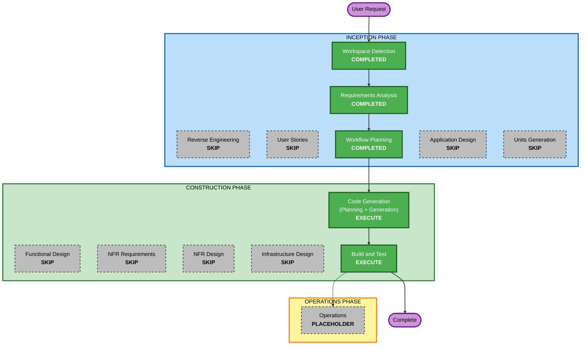

# 실행 계획 (4차 워크플로: 등록 일자와 완료 일자 표시)

## 상세 분석 요약

### 변환 범위 (Brownfield)
- **변환 유형**: 단일 애플리케이션 안의 여러 계층 변경 (아키텍처 변경 없음)
- **주요 변경**: 완료 시각 열 추가와 기존 DB 이전, API 응답 필드 추가, 목록 행에 날짜 표시
- **관련 컴포넌트**: `db.py`(스키마, 이전), `serialization.py`(Todo, 변환), `repository.py`(완료 시각 기록), `web/index.html`, `web/app.js`, `web/app.css`, 테스트, README, 리버스 엔지니어링 문서(api-documentation 등)

### 변경 영향 평가
- **사용자 대상 변경**: 예 - 목록 각 행에 등록 일자와 완료 일자가 보인다
- **구조 변경**: 아니오 - 새 모듈이나 계층이 없다
- **데이터 모델 변경**: 예 - `todos.completed_at TEXT NULL` 열 추가. 기존 행은 NULL
- **API 변경**: 예(하위 호환) - 응답에 `completed_at` 필드 추가. 요청 형식, 기존 필드, 상태 코드는 그대로
- **NFR 영향**: 작음 - 시작 시 이전(DNFR-01, 02), 백업 안내(DNFR-03)

### 컴포넌트 관계
- **주 컴포넌트**: `todo_api` 패키지 (단일 Flask 앱)
- **공유 컴포넌트**: `serialization.Todo` - 저장소, 라우트, 테스트가 모두 사용 (Minor 변경, 필드 추가)
- **의존 컴포넌트**: 웹 화면(`app.js`)이 API 응답을 사용 (Minor 변경)
- **지원 컴포넌트**: 백업 도구(변경 없음, 새 열이 있는 DB도 그대로 복사), CI(변경 없음)

### 위험 평가
- **위험 수준**: Medium (실제 사용 중인 DB 파일의 구조를 바꾼다)
- **완화**: 열 추가만 하고 한 트랜잭션에서 수행. 이전 전에 실제 DB를 백업 도구로 백업. 이전 코드는 새 열을 무시하므로 코드만 되돌려도 동작
- **롤백 복잡도**: Easy (코드 되돌리기, 필요 시 백업 복원)
- **테스트 복잡도**: Moderate (이전 경로, 시간대에 따른 날짜 변환, 화면 표시)

## 워크플로 시각화



### 텍스트 대안

```text
INCEPTION PHASE
- Workspace Detection        : COMPLETED
- Reverse Engineering        : SKIP (산출물이 최신)
- Requirements Analysis      : COMPLETED
- User Stories               : SKIP
- Workflow Planning          : COMPLETED
- Application Design         : SKIP
- Units Generation           : SKIP

CONSTRUCTION PHASE
- Functional Design          : SKIP
- NFR Requirements           : SKIP
- NFR Design                 : SKIP
- Infrastructure Design      : SKIP
- Code Generation            : EXECUTE
- Build and Test             : EXECUTE

실행 순서: Workflow Planning -> Code Generation -> Build and Test -> Complete
```

## 실행할 단계

### 🔵 INCEPTION PHASE
- [x] Workspace Detection (COMPLETED)
- [x] Reverse Engineering (SKIPPED - 산출물이 최신)
- [x] Requirements Analysis (COMPLETED)
- [x] User Stories (SKIPPED)
  - **근거**: 사용자 유형이 1명이고 기존 스토리(목록 보기, 완료 체크)의 표시 항목을 늘리는 변경이다. 수용 기준은 요구사항 DFR-01~05로 충분하다
- [x] Execution Plan (COMPLETED)
- [x] Application Design - SKIP
  - **근거**: 새 컴포넌트나 서비스가 없다. 기존 모듈 경계 안의 변경이다
- [x] Units Generation - SKIP
  - **근거**: 단일 유닛 `dates`

### 🟢 CONSTRUCTION PHASE
- [x] Functional Design - SKIP
  - **근거**: 데이터 모델 변경은 NULL 허용 열 하나이고, 업무 규칙(완료/해제 시 기록, 변화 없는 요청, 기존 행 처리, 표시 규칙)은 요구사항 DFR-01~04와 확인 질문 답변으로 모두 정해졌다. 테스트할 속성은 코드 생성 계획에 적는다(PBT-01은 부분 적용 모드에서 권고)
- [x] NFR Requirements - SKIP
  - **근거**: 기술 스택이 정해져 있고 새 의존성이 없다. 필요한 NFR은 요구사항 DNFR-01~09에 있다
- [x] NFR Design - SKIP
  - **근거**: NFR Requirements를 건너뛴다. 기존 패턴(쓰기 트랜잭션, 시작 시 스키마 초기화, 텍스트 전용 렌더링)을 그대로 따른다
- [x] Infrastructure Design - SKIP
  - **근거**: 로컬 전용, 인프라 변경 없음
- [x] Code Generation - EXECUTE (ALWAYS) (COMPLETED)
- [x] Build and Test - EXECUTE (ALWAYS) (COMPLETED)

### 🟡 OPERATIONS PHASE
- [x] Operations - PLACEHOLDER (수행할 활동 없음)

## 변경 순서 (Brownfield)
1. 데이터 계층: 스키마와 이전(`db.py`), `Todo`와 변환(`serialization.py`), 완료 시각 기록(`repository.py`)
2. API 응답: 직렬화 변경으로 자동 반영, 라우트 확인
3. 웹 화면: 템플릿, 날짜 형식 변환, 스타일
4. 테스트: 기존 기대값 갱신, 이전, 저장소, API, 화면, 속성 기반 테스트
5. 문서: README, 리버스 엔지니어링 문서, 코드 요약
6. 실제 DB 백업 후 서버 시작

## 성공 기준
- 목록 각 행에 `등록 yyyy/mm/dd`와 규칙에 따른 완료 일자가 보인다
- 기존 DB 파일이 데이터 손실 없이 새 구조로 이전된다
- 기존 테스트가 모두 통과하고 새 테스트가 추가된다
- 서버가 시작되어 `http://127.0.0.1:8000/api_test`에서 확인할 수 있다
- 적용 대상 확장 규칙에 차단 발견이 없다
