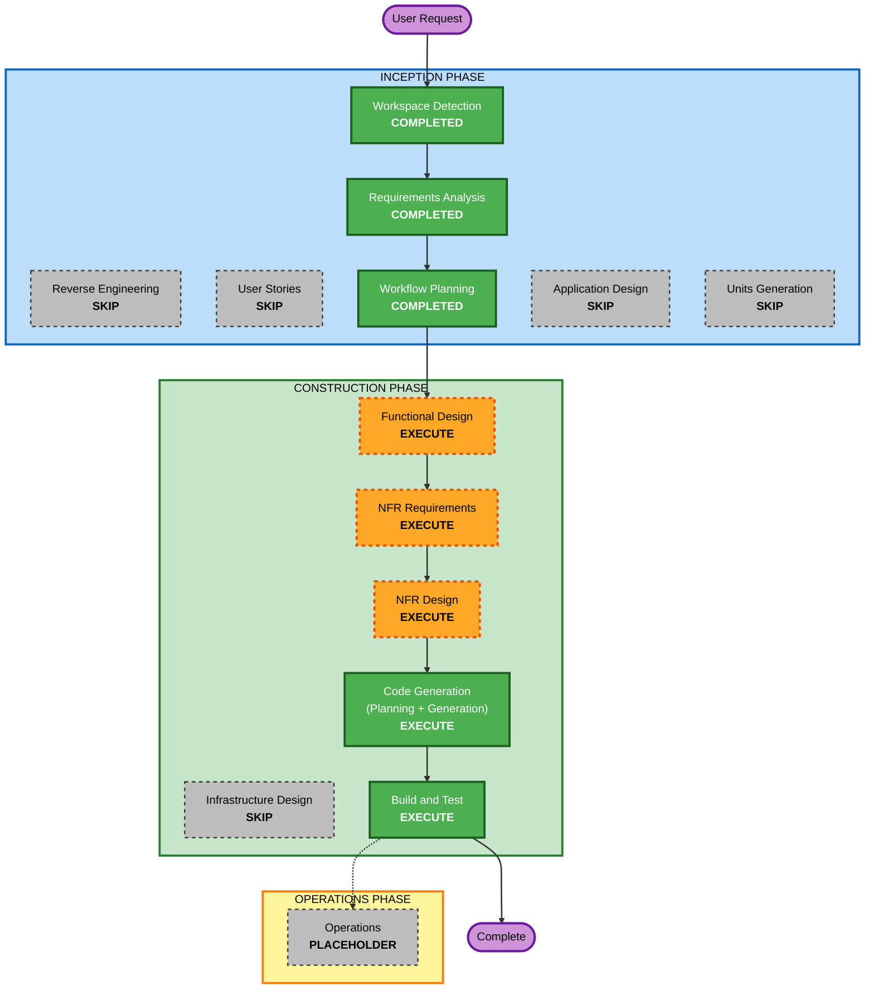

# 실행 계획 (Execution Plan)

## 상세 분석 요약

### 변경 영향 평가
- **사용자 대상 변경**: 예 - 새 REST API(할 일 추가/조회/완료 상태 변경/삭제, 상태 확인)를 제공
- **구조 변경**: 예 - 신규 프로젝트. 단일 Flask 애플리케이션(앱 팩토리 + 모듈 분리)
- **데이터 모델 변경**: 예 - 신규 `todos` 테이블(논리 삭제 컬럼 포함)
- **API 변경**: 예 - 신규 엔드포인트 6개
- **NFR 영향**: 예 - 보안(API 키 인증, 입력 검증, 요청 제한, 로깅, 오류 처리), 복원력(상태 확인, 타임아웃, 백업/복원), 속성 기반 테스트

### 계층별 영향
- **애플리케이션 계층**: 신규 코드 전체, 의존성(Flask, 요청 제한 라이브러리, pytest, Hypothesis), 환경 변수(API 키, DB 경로)
- **인프라 계층**: 해당 없음 (로컬 PC 전용)
- **운영 계층**: 구조화 로깅, DB 백업/복원 절차. 경보/대시보드/배포 파이프라인은 해당 없음

### 위험 평가
- **위험 수준**: Low (신규 격리 프로젝트, 잘 알려진 기술, 로컬 전용)
- **롤백 복잡도**: Easy (git 되돌리기, DB 파일 백업 복원)
- **테스트 복잡도**: Simple ~ Moderate (예제 기반 API 테스트 + 속성 기반 테스트)

### 작업 단위
- 단일 유닛 `todo-api` 하나로 진행한다.

## 워크플로 시각화



### 텍스트 대안

```text
INCEPTION PHASE
- Workspace Detection        : COMPLETED
- Reverse Engineering        : SKIP (Greenfield)
- Requirements Analysis      : COMPLETED
- User Stories               : SKIP
- Workflow Planning          : COMPLETED
- Application Design         : SKIP
- Units Generation           : SKIP

CONSTRUCTION PHASE (유닛: todo-api)
- Functional Design          : EXECUTE
- NFR Requirements           : EXECUTE
- NFR Design                 : EXECUTE
- Infrastructure Design      : SKIP
- Code Generation            : EXECUTE
- Build and Test             : EXECUTE

OPERATIONS PHASE
- Operations                 : PLACEHOLDER

실행 순서:
Workflow Planning -> Functional Design -> NFR Requirements -> NFR Design
-> Code Generation -> Build and Test -> Complete
```

## 실행할 단계

### 🔵 INCEPTION PHASE
- [x] Workspace Detection (COMPLETED)
- [x] Reverse Engineering (SKIPPED - Greenfield)
- [x] Requirements Analysis (COMPLETED)
- [x] User Stories (SKIPPED)
  - **근거**: 사용자 유형이 하나뿐인 단순 CRUD이고, 요구사항 문서의 기능 요구사항이 수용 기준 역할을 충분히 한다
- [x] Execution Plan (COMPLETED)
- [ ] Application Design - SKIP
  - **근거**: 단일 소규모 애플리케이션으로 컴포넌트 경계가 단순하다(앱 팩토리, 라우트, DB, 인증). 모듈 구성은 Code Generation 계획에서 정의하면 충분하다
- [ ] Units Generation - SKIP
  - **근거**: 단일 유닛(`todo-api`)이며 분해할 대상이 없다

### 🟢 CONSTRUCTION PHASE (유닛: todo-api)
- [x] Functional Design - EXECUTE (간결하게) (COMPLETED)
  - **근거**: 신규 데이터 모델(`todos` 테이블, 논리 삭제)과 업무 규칙(입력 검증, 완료 상태 전환, 삭제 항목 취급, API 계약)을 확정해야 한다. 보안 규칙이 요구하는 오용 시나리오(SECURITY-11)와 테스트 가능한 속성 목록도 여기서 정리한다
- [x] NFR Requirements - EXECUTE (COMPLETED)
  - **근거**: 기술 스택(Python/Flask 버전, 요청 제한 라이브러리, Hypothesis)을 확정해야 하고, 복원력 확장이 사용자에게 직접 묻도록 정한 질문(CI/CD, 롤백, 배포 방식, 장애 대응)이 남아 있다
- [x] NFR Design - EXECUTE (COMPLETED)
  - **근거**: 인증, 요청 제한, 구조화 로깅, 전역 오류 처리, 백업/복원 패턴을 설계에 반영해야 한다. 복원력 테스트 접근 방식 질문(RESILIENCY-14)도 이 단계에서 확인한다
- [ ] Infrastructure Design - SKIP
  - **근거**: 로컬 PC 전용 실행으로 배포 인프라와 클라우드 리소스가 없다
- [ ] Code Generation - EXECUTE (ALWAYS)
  - **근거**: 구현 계획 수립 후 애플리케이션 코드, 테스트, README를 생성한다
- [ ] Build and Test - EXECUTE (ALWAYS)
  - **근거**: 빌드, 테스트 실행, 의존성 취약점 스캔 지침을 작성하고 검증한다

### 🟡 OPERATIONS PHASE
- [ ] Operations - PLACEHOLDER
  - **근거**: 향후 배포 및 모니터링 워크플로용 자리표시자

## 예상 일정
- **실행 단계 수**: 남은 단계 5개 (Functional Design, NFR Requirements, NFR Design, Code Generation, Build and Test)
- **승인 게이트**: 단계마다 1회, Code Generation은 계획과 생성 결과 각각 1회
- **질문 라운드**: NFR Requirements와 NFR Design에서 각 1회 예상

## 성공 기준
- **주요 목표**: 요구사항 문서의 기능 요구사항 6개를 충족하는, 로컬에서 실행 가능한 Flask To-Do REST API
- **주요 산출물**:
  - 애플리케이션 코드 (워크스페이스 루트)
  - pytest 예제 기반 테스트와 Hypothesis 속성 기반 테스트
  - 버전이 고정된 의존성 파일
  - 한국어 README (실행 방법, 환경 변수, API 사용 예시, 백업/복원 절차)
  - 빌드 및 테스트 지침 문서
- **품질 게이트**:
  - 모든 테스트 통과
  - 적용 대상 Security, Resiliency, PBT(부분) 규칙에 차단 발견 없음
  - 의존성 취약점 스캔 절차 문서화
