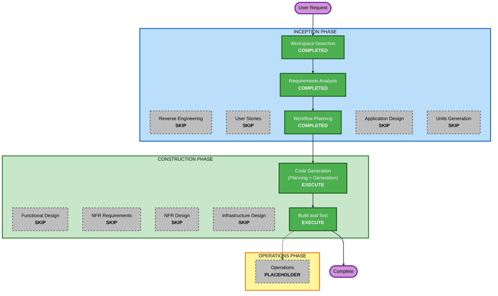

# 실행 계획 (5차 워크플로: 프로젝트를 D 드라이브로 이전)

## 상세 분석 요약

### 변환 범위 (Brownfield)
- **변환 유형**: 배포 위치 변경 (애플리케이션 구조 변경 없음)
- **주요 변경**: 배치 파일 3개의 위치 판별, 새 위치로 복사, 가상 환경 재생성, Windows 권한, 바로 가기, 기존 폴더 삭제
- **관련 컴포넌트**: `todo-*.bat`, README, 실행 데이터(`.env`, `instance`, `backups`, `logs`), 바탕화면 바로 가기

### 변경 영향 평가
- **사용자 대상 변경**: 예 - 프로젝트 위치와 바로 가기 대상이 바뀐다. 화면과 API는 같다
- **구조 변경**: 아니오
- **데이터 모델 변경**: 아니오 (DB 파일을 그대로 옮김)
- **API 변경**: 아니오
- **NFR 영향**: 있음 - 리눅스 권한이 적용되지 않는 드라이브로 옮기므로 Windows 권한으로 보완. 파일 접근 속도가 느려짐

### 위험 평가
- **위험 수준**: Medium (기존 폴더 삭제는 되돌릴 수 없음)
- **완화**: 백업 후 복사, 새 위치에서 git 커밋·키·DB 일치와 테스트·실행을 모두 확인한 뒤 마지막에 삭제. 확인 실패 시 삭제하지 않음
- **롤백 복잡도**: 삭제 전에는 Easy(옛 폴더 그대로). 삭제 후에는 새 위치의 git 저장소와 GitHub 원격에서 코드를, 새 위치의 백업에서 DB를 되살릴 수 있음
- **테스트 복잡도**: Simple

## 워크플로 시각화



### 텍스트 대안

```text
INCEPTION PHASE
- Workspace Detection        : COMPLETED
- Reverse Engineering        : SKIP (산출물이 최신)
- Requirements Analysis      : COMPLETED
- User Stories               : SKIP
- Workflow Planning          : COMPLETED
- Application Design         : SKIP
- Units Generation           : SKIP

CONSTRUCTION PHASE
- Functional Design          : SKIP
- NFR Requirements           : SKIP
- NFR Design                 : SKIP
- Infrastructure Design      : SKIP
- Code Generation            : EXECUTE
- Build and Test             : EXECUTE

실행 순서: Workflow Planning -> Code Generation -> Build and Test -> Complete
```

## 실행할 단계

### 🔵 INCEPTION PHASE
- [x] Workspace Detection (COMPLETED)
- [x] Reverse Engineering (SKIPPED - 산출물이 최신)
- [x] Requirements Analysis (COMPLETED)
- [x] User Stories (SKIPPED)
  - **근거**: 사용자 흐름은 그대로이고 위치만 바뀐다
- [x] Execution Plan (COMPLETED)
- [x] Application Design - SKIP
  - **근거**: 새 컴포넌트 없음
- [x] Units Generation - SKIP
  - **근거**: 단일 유닛 `relocate`

### 🟢 CONSTRUCTION PHASE
- [x] Functional Design - SKIP
  - **근거**: 업무 로직 변경 없음
- [x] NFR Requirements - SKIP
  - **근거**: 새 기술 없음. 필요한 NFR은 요구사항 RNFR-01~03에 있음
- [x] NFR Design - SKIP
  - **근거**: NFR Requirements를 건너뜀
- [x] Infrastructure Design - SKIP
  - **근거**: 로컬 PC 안의 위치 변경이며 결정 사항은 요구사항 문서 2장에 있음
- [x] Code Generation - EXECUTE (ALWAYS) (COMPLETED)
- [x] Build and Test - EXECUTE (ALWAYS) (COMPLETED)

### 🟡 OPERATIONS PHASE
- [x] Operations - PLACEHOLDER (수행할 활동 없음)

## 성공 기준
- `D:\workspace\to_do`에서 자동 테스트 전체 통과
- 배치 파일 3개가 새 위치에서 동작하고 바탕화면 바로 가기가 새 위치를 가리킴
- 할 일 데이터와 API 키가 이전 전과 같음
- 확인 후 기존 폴더 삭제, 새 위치에서 서버 실행 중
