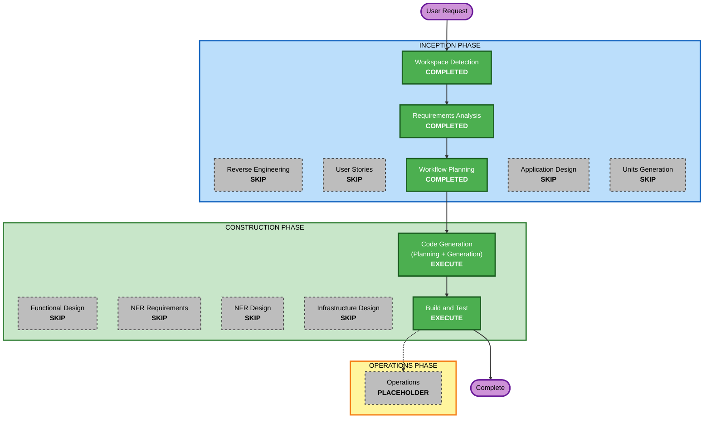

# 실행 계획 (3차 워크플로: 서버 종료용 실행 파일)

## 상세 분석 요약

### 변환 범위 (Brownfield)
- **변환 유형**: 단일 컴포넌트 변경 (실행 로직 모듈에 명령 하나, 배치 파일 하나 추가)
- **관련 컴포넌트**: 실행 로직(`launcher.py`), 테스트, README, 수동 확인 절차

### 변경 영향 평가
- **사용자 대상 변경**: 예 - 더블클릭으로 서버를 끄는 실행 파일이 생긴다
- **구조 변경**: 아니오
- **데이터 모델 변경**: 아니오
- **API 변경**: 아니오 - HTTP 엔드포인트는 바뀌지 않는다
- **NFR 영향**: 작음 - 잘못된 프로세스를 끄지 않는 것이 핵심 (SNFR-02)

### 위험 평가
- **위험 수준**: Low (서버와 화면 코드는 건드리지 않음. 잘못되어도 서버가 꺼지거나 안 꺼지는 것이며 데이터는 영향 없음)
- **롤백 복잡도**: Easy
- **테스트 복잡도**: Simple

## 워크플로 시각화



### 텍스트 대안

```text
INCEPTION PHASE
- Workspace Detection        : COMPLETED
- Reverse Engineering        : SKIP (산출물이 최신)
- Requirements Analysis      : COMPLETED
- User Stories               : SKIP
- Workflow Planning          : COMPLETED
- Application Design         : SKIP
- Units Generation           : SKIP

CONSTRUCTION PHASE
- Functional Design          : SKIP
- NFR Requirements           : SKIP
- NFR Design                 : SKIP
- Infrastructure Design      : SKIP
- Code Generation            : EXECUTE
- Build and Test             : EXECUTE

실행 순서: Workflow Planning -> Code Generation -> Build and Test -> Complete
```

## 실행할 단계

### 🔵 INCEPTION PHASE
- [x] Workspace Detection (COMPLETED)
- [x] Reverse Engineering (SKIPPED - 산출물이 최신)
- [x] Requirements Analysis (COMPLETED)
- [x] User Stories (SKIPPED)
  - **근거**: 기존 스토리 US-04(서버 끄기)에 수단 하나를 더하는 변경이다. 새 사용자 흐름이 없다
- [x] Execution Plan (COMPLETED)
- [x] Application Design - SKIP
  - **근거**: 새 컴포넌트가 없다. 기존 실행 로직 모듈 안의 변경이다
- [x] Units Generation - SKIP
  - **근거**: 단일 유닛

### 🟢 CONSTRUCTION PHASE
- [x] Functional Design - SKIP
  - **근거**: 새 데이터 모델이 없고 업무 규칙은 요구사항 문서의 SFR-02(종료 대상)로 충분히 정해졌다
- [x] NFR Requirements - SKIP
  - **근거**: 기술 스택이 정해져 있고 새 의존성이 없다. 필요한 NFR은 요구사항 문서의 SNFR-01~08에 있다
- [x] NFR Design - SKIP
  - **근거**: NFR Requirements를 건너뛴다. 기존 패턴(순수 계산과 부수 효과 분리, 서버 정리 방식)을 그대로 따른다
- [x] Infrastructure Design - SKIP
  - **근거**: 로컬 전용
- [x] Code Generation - EXECUTE (ALWAYS) (COMPLETED)
- [x] Build and Test - EXECUTE (ALWAYS) (COMPLETED)

### 🟡 OPERATIONS PHASE
- [x] Operations - PLACEHOLDER (수행할 활동 없음)

## 변경 순서 (Brownfield)
1. `launcher.py`에 종료 명령 추가
2. 테스트 추가
3. `todo-stop.bat` 추가
4. README와 수동 확인 절차 갱신
5. 바탕화면 바로 가기 생성

## 성공 기준
- `todo-stop.bat`으로 이 프로젝트의 서버가 꺼지고 결과가 안내된다
- 다른 프로세스를 끄지 않는다 (자동 테스트로 확인)
- 기존 테스트 298개가 그대로 통과한다
- 적용 대상 확장 규칙에 차단 발견이 없다
