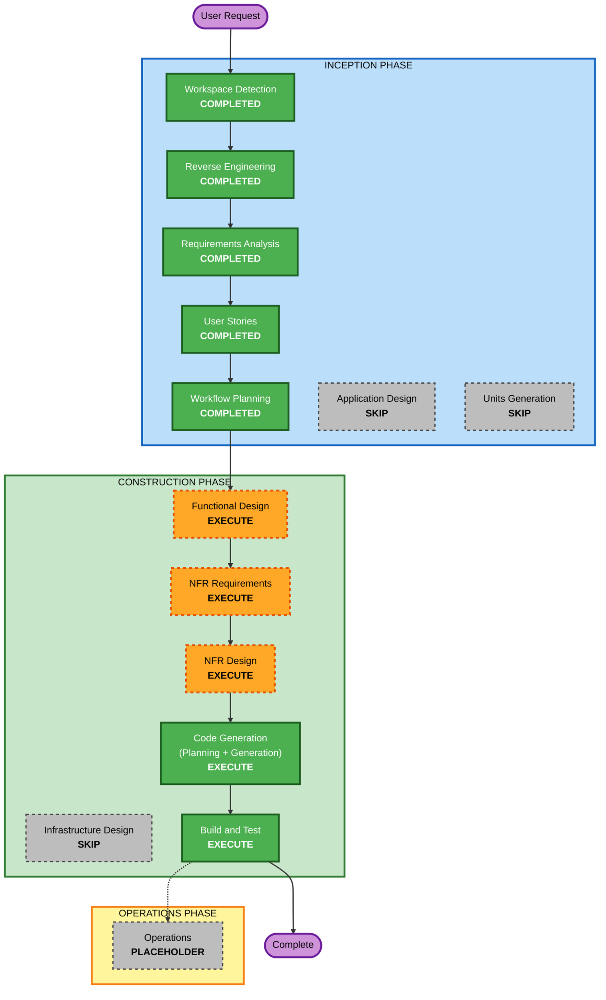

# 실행 계획 (2차 워크플로: 웹 화면 추가)

1차 워크플로의 실행 계획(`execution-plan.md`)은 완료된 기록으로 보존한다.

## 상세 분석 요약

### 변환 범위 (Brownfield)
- **변환 유형**: 단일 컴포넌트 변경 (기존 Flask 앱에 화면 제공 기능 추가). 아키텍처 변경 아님
- **주요 변경**: 화면 파일(HTML, CSS, JavaScript) 신규, 화면 제공 라우트 신규, HTML 보안 헤더 추가, Windows 실행 파일과 보조 스크립트 신규, 브라우저 자동화 테스트 신규
- **관련 컴포넌트**: 앱 팩토리, 요청 훅(응답 헤더), CI 워크플로, 의존성 고정 파일, README

### 변경 영향 평가
- **사용자 대상 변경**: 예 - 사용자가 직접 쓰는 화면과 실행 파일이 새로 생긴다
- **구조 변경**: 아니오 - 기존 구조 안에 라우트 묶음 하나와 정적 파일 디렉터리가 추가된다
- **데이터 모델 변경**: 아니오 - 테이블과 스키마는 그대로다
- **API 변경**: 아니오 - 기존 엔드포인트 6개의 계약은 바꾸지 않는다. 화면 제공 경로(`/api_test`와 그 하위의 정적 파일)만 추가된다
- **NFR 영향**: 예 - HTML 보안 헤더(SECURITY-04가 새로 적용 대상), 브라우저의 키 보관, 화면의 오류 처리와 제한 시간, 테스트 의존성 추가

### 계층별 영향
- **애플리케이션 계층**: 신규 라우트와 정적 파일, 응답 헤더 로직 수정, 설정 추가 가능성(실행 파일용)
- **인프라 계층**: 해당 없음 (로컬 전용)
- **운영 계층**: Windows 실행 파일, CI에 브라우저 설치와 자동화 테스트 단계 추가, README 문제 해결 보강

### 컴포넌트 관계 (Brownfield)

| 컴포넌트 | 변경 유형 | 이유 | 우선순위 |
|---|---|---|---|
| `src/todo_api/routes/` 화면 라우트 (신규) | Major | 화면과 정적 파일 제공 | Critical |
| `src/todo_api/static/` 화면 파일 (신규) | Major | 화면 본체 | Critical |
| `src/todo_api/app.py` | Minor | 새 라우트 묶음 등록 | Critical |
| `src/todo_api/logging_setup.py` | Minor | HTML 응답용 보안 헤더 추가 | Critical |
| Windows 실행 파일과 보조 스크립트 (신규) | Major | 서버 시작, 포트 선택, 키 생성과 복사 | Important |
| `tests/` | Major | 서버 쪽 테스트와 브라우저 자동화 테스트 추가 | Critical |
| `requirements-dev.txt` | Minor | Playwright 등 테스트 의존성 고정 | Important |
| `.github/workflows/ci.yml` | Minor | 브라우저 설치와 자동화 테스트 단계 | Important |
| `README.md` | Minor | 화면과 실행 파일 사용법, 문제 해결 | Important |
| 기존 API 모듈 (`auth`, `validation`, `repository`, `db`, `routes/todos` 등) | 변경 없음 | 계약 유지 | - |

### 위험 평가
- **위험 수준**: Medium
  - 브라우저에서 API 키를 다루는 코드가 새로 생긴다 (보안 민감)
  - 모든 응답에 붙는 헤더 로직을 고치므로 기존 API 응답에 영향이 갈 수 있다. 기존 테스트 161개로 회귀를 막는다
  - Playwright 실행 환경(WSL의 시스템 라이브러리)이 아직 확인되지 않았다
  - Windows 배치 파일과 WSL 사이의 동작은 자동 테스트가 어렵다
- **롤백 복잡도**: Easy (git으로 되돌림. DB 스키마 변경이 없어 데이터 복원 불필요)
- **테스트 복잡도**: Moderate (브라우저 자동화 도입, 실행 파일은 수동 확인)

### 작업 단위
- 단일 유닛 `web-ui`로 진행한다. 화면, 화면 제공 라우트, Windows 실행 파일, 관련 테스트를 포함한다.

## 워크플로 시각화



### 텍스트 대안

```text
INCEPTION PHASE
- Workspace Detection        : COMPLETED
- Reverse Engineering        : COMPLETED
- Requirements Analysis      : COMPLETED
- User Stories               : COMPLETED
- Workflow Planning          : COMPLETED
- Application Design         : SKIP
- Units Generation           : SKIP

CONSTRUCTION PHASE (유닛: web-ui)
- Functional Design          : EXECUTE
- NFR Requirements           : EXECUTE
- NFR Design                 : EXECUTE
- Infrastructure Design      : SKIP
- Code Generation            : EXECUTE
- Build and Test             : EXECUTE

OPERATIONS PHASE
- Operations                 : PLACEHOLDER

실행 순서:
Workflow Planning -> Functional Design -> NFR Requirements -> NFR Design
-> Code Generation -> Build and Test -> Complete
```

## 실행할 단계

### 🔵 INCEPTION PHASE
- [x] Workspace Detection (COMPLETED)
- [x] Reverse Engineering (COMPLETED)
- [x] Requirements Analysis (COMPLETED)
- [x] User Stories (COMPLETED)
- [x] Execution Plan (COMPLETED)
- [ ] Application Design - SKIP
  - **근거**: 새 요소는 화면 파일, 화면 제공 라우트, 실행 파일 세 가지이고 서로의 경계가 단순하다. 화면 내부의 컴포넌트 구성은 Functional Design의 프런트엔드 컴포넌트 문서에서, 서버 쪽 구성은 NFR Design의 논리 컴포넌트 문서에서 정의하면 충분하다. 별도 서비스 계층이나 컴포넌트 간 계약을 새로 설계할 것이 없다
- [ ] Units Generation - SKIP
  - **근거**: 화면과 실행 파일은 함께 배포되고 함께 검증되므로 단일 유닛 `web-ui`로 다룬다. 병렬로 개발할 대상이 없다

### 🟢 CONSTRUCTION PHASE (유닛: web-ui)
- [x] Functional Design - EXECUTE (COMPLETED)
  - **근거**: 화면의 상태와 전환(키 입력, 목록, 오류), 컴포넌트 구성, 사용자 동작별 흐름, 실행 파일의 판단 로직(이미 실행 중인지 확인, 빈 포트 선택, 키 생성과 복사)을 정해야 한다. 프런트엔드가 있으므로 프런트엔드 컴포넌트 문서도 작성한다. 키 보관의 오용 시나리오(SECURITY-11)와 테스트 가능한 속성(PBT)도 여기서 식별한다
- [x] NFR Requirements - EXECUTE (COMPLETED)
  - **근거**: Playwright 실행 환경(WSL 시스템 라이브러리, CI 구성)을 사용자에게 확인해야 한다. 추가할 테스트 의존성과 버전, 콘텐츠 보안 정책의 구체 값, 제한 시간 수치를 확정한다
- [x] NFR Design - EXECUTE (COMPLETED)
  - **근거**: HTML 보안 헤더 적용 방식(기존 요청 훅 수정), 정적 파일 제공과 경로 탈출 차단, 브라우저 키 보관, 화면의 오류 처리와 제한 시간 패턴을 설계에 반영한다
- [ ] Infrastructure Design - SKIP
  - **근거**: 로컬 PC 전용으로 배포 인프라가 없다. 1차와 같다
- [x] Code Generation - EXECUTE (ALWAYS) (COMPLETED)
  - **근거**: 계획 수립 후 화면 파일, 라우트, 실행 파일, 테스트, 문서를 생성하고 기존 파일을 수정한다
- [x] Build and Test - EXECUTE (ALWAYS) (COMPLETED)
  - **근거**: 기존 161개 회귀, 새 서버 쪽 테스트, 브라우저 자동화 테스트, 취약점 스캔, 실행 파일 수동 확인 절차

### 🟡 OPERATIONS PHASE
- [x] Operations - PLACEHOLDER (수행할 활동 없음)
  - **근거**: 향후 배포 및 모니터링 워크플로용 자리표시자

## 변경 순서 (Brownfield)

패키지가 하나라 패키지 간 순서는 없다. 파일 수준의 순서는 다음과 같으며 세부는 Code Generation 계획에서 확정한다.

1. 서버 쪽: 화면 제공 라우트와 보안 헤더 (기존 테스트가 계속 통과하는지 먼저 확인)
2. 화면 파일: HTML, CSS, JavaScript
3. 테스트: 서버 쪽 테스트, 브라우저 자동화 테스트
4. Windows 실행 파일과 보조 스크립트
5. 의존성 고정, CI, README

- **갱신 방식**: 순차
- **테스트 체크포인트**: 1번 직후 기존 161개 실행, 3번 직후 전체 실행
- **롤백**: 이번 변경 전 커밋으로 되돌림 (1차 워크플로의 롤백 절차와 같음)

## 예상 일정
- **실행 단계 수**: 남은 단계 5개 (Functional Design, NFR Requirements, NFR Design, Code Generation, Build and Test)
- **승인 게이트**: 단계마다 1회, Code Generation은 계획과 생성 결과 각각 1회
- **질문 라운드**: Functional Design, NFR Requirements, NFR Design에서 각 1회 예상

## 성공 기준
- **주요 목표**: `/api_test`에서 사용자 스토리 US-05~US-18의 수용 기준을 충족하는 화면, 그리고 US-01~US-04를 충족하는 Windows 실행 파일
- **주요 산출물**:
  - 화면 파일과 화면 제공 라우트
  - Windows 실행 파일과 보조 스크립트
  - 서버 쪽 테스트와 Playwright 브라우저 자동화 테스트
  - 갱신된 의존성 고정 파일, CI 워크플로, README
- **품질 게이트**:
  - 기존 테스트 161개가 변경 없이 통과
  - 새 테스트 모두 통과
  - 적용 대상 Security, Resiliency, PBT(부분) 규칙에 차단 발견 없음
  - 의존성 취약점 스캔 통과
- **통합 테스트**: 실제 서버와 실제 브라우저로 화면과 API가 함께 동작하는지 확인
- **운영 준비**: 화면 관련 문제 해결 절차가 README에 있고, 실행 파일 수동 확인 절차가 문서화됨
