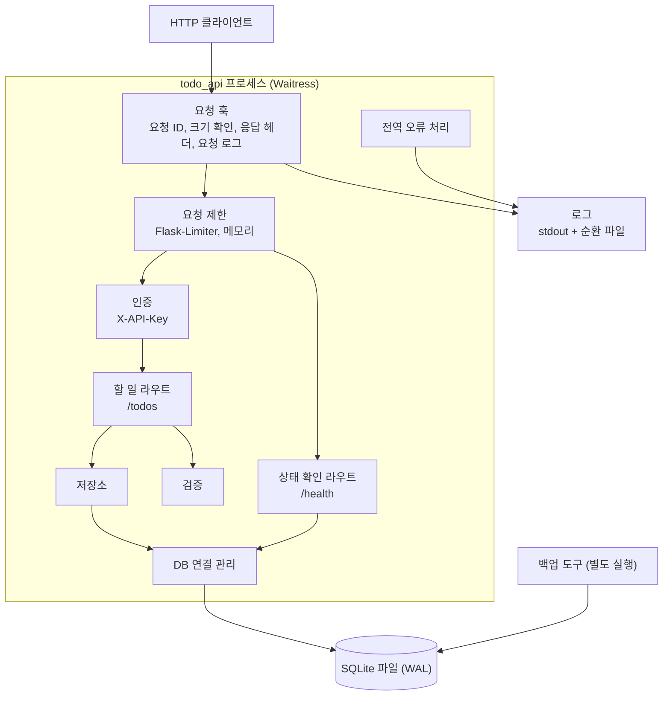
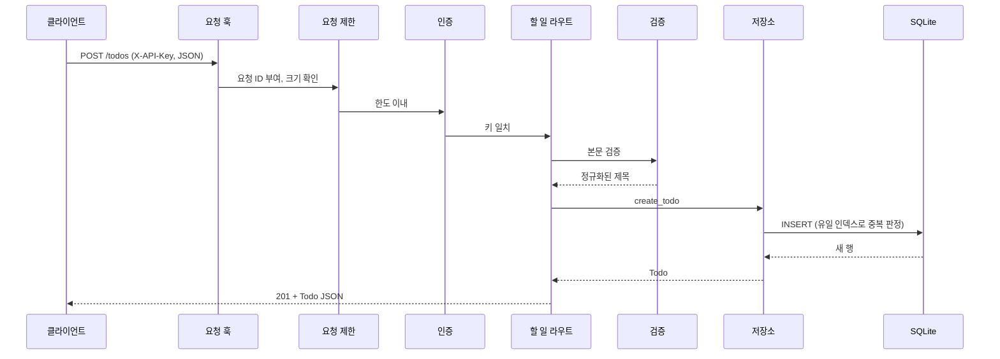

# 시스템 아키텍처

## 시스템 개요
단일 프로세스 Flask 애플리케이션이다. Waitress(WSGI 서버)가 `127.0.0.1:8000`에서 실행하고, 데이터는 로컬 SQLite 파일(WAL 모드) 하나에 저장한다. 외부 서비스 연동은 없다.
설계 근거는 `aidlc-docs/construction/todo-api/`의 기능 설계, NFR 요구사항, NFR 설계 문서에 있다.

## 아키텍처 다이어그램



### 텍스트 대안
```text
HTTP 클라이언트
  -> 요청 훅(요청 ID, 본문 크기 확인)
  -> 요청 제한
  -> [보호 라우트] 인증 -> 할 일 라우트 -> 검증 -> 저장소 -> DB 연결 관리 -> SQLite
  -> [공개 라우트] 상태 확인 라우트 -> DB 연결 관리 -> SQLite
어느 단계의 오류든 전역 오류 처리기가 공통 JSON 형식으로 변환한다.
백업 도구는 앱과 별도로 실행되어 SQLite 파일을 직접 다룬다.
```

## 컴포넌트 설명

| 컴포넌트 | 파일 | 목적 | 의존 | 유형 |
|---|---|---|---|---|
| 설정 | `config.py` | 환경 변수, API 키 검증, 파일 보호 도우미 | - | Application |
| 앱 팩토리 | `app.py` | 컴포넌트 조립 | 전부 | Application |
| 로깅과 요청 훅 | `logging_setup.py` | JSON 로그, 요청 ID, 공통 응답 헤더 | 설정 | Application |
| 요청 제한 | `rate_limit.py` | 전체 한도, 인증 실패 한도 | 설정 | Application |
| 인증 | `auth.py` | API 키 검증 | 요청 제한, 오류, 로깅 | Application |
| 검증 | `validation.py` | 스키마 기반 입력 검증 | 오류 | Application |
| 직렬화 | `serialization.py` | 행과 Todo 표현 변환 | - | Application |
| 저장소 | `repository.py` | Todo SQL | DB 연결 관리, 직렬화 | Application |
| DB 연결 관리 | `db.py` | 연결, 스키마, 재시도 | 설정, 오류, 로깅 | Application |
| 라우트 | `routes/todos.py`, `routes/health.py` | HTTP 엔드포인트 | 위 컴포넌트 | Application |
| 오류 처리 | `errors.py` | 공통 오류 형식 | 로깅 | Application |
| 서버 진입점 | `server.py` | Waitress 실행 | 앱 팩토리 | Application |
| 백업 도구 | `backup.py` | 백업/복원 | 설정 | Application (운영 도구) |
| 테스트 | `tests/` | 161개 테스트 | 전부 | Test |

## 데이터 흐름 (할 일 추가)



### 텍스트 대안
```text
클라이언트 -> 요청 훅 -> 요청 제한 -> 인증 -> 라우트 -> 검증 -> 저장소 -> SQLite
실패 지점별 응답: 크기 초과 413, 한도 초과 429, 키 불일치 401, 검증 실패 400,
중복 제목 409, DB 잠금(1회 재시도 후) 503, 그 밖의 오류 500
```

## 통합 지점
- **외부 API**: 없음
- **데이터베이스**: SQLite 파일 `instance/todo.db` (테이블 `todos` 하나)
- **서드파티 서비스**: 없음

## 인프라 구성 요소
- **IaC**: 없음
- **배포 모델**: 로컬 PC에서 수동 실행. 자동 배포 없음
- **네트워킹**: 루프백(127.0.0.1) 바인딩. WSL2에서 실행하면 Windows에서도 `127.0.0.1:8000`으로 접근 가능
- **CI**: GitHub Actions (`.github/workflows/ci.yml`), 테스트와 취약점 스캔만 수행

## 2차 워크플로(웹 화면)에서 추가된 것

- **화면**: 같은 Flask 프로세스가 `/api_test`에서 한 페이지짜리 화면을 제공한다. 화면의 스크립트는 브라우저에 저장한 API 키로 기존 `/todos` API를 호출한다. 화면과 API는 같은 출처다.
- **요청 흐름의 변화**: 요청 제한 뒤의 라우트 분기에 `/api_test`(인증 없음, 고정 목록의 파일만 응답)가 더해졌고, 응답 후처리에서 보안 헤더 컴포넌트가 모든 응답에 헤더를 붙인다.
- **실행 파일**: Windows 배치 파일이 WSL의 실행 로직(`launcher.py`)을 호출한다. 실행 로직은 키 파일을 준비하고, 8000~8009번 포트의 상태를 판정해 실행 중인 서버를 재사용하거나 빈 포트에 서버를 별도 프로세스로 띄운 뒤, 응답을 확인하고 Windows의 기본 브라우저를 연다.
- **변경되지 않은 것**: DB 스키마, 기존 API 6개의 계약, 인증/검증/저장소 컴포넌트.

자세한 설계는 `aidlc-docs/construction/web-ui/`에 있다.
