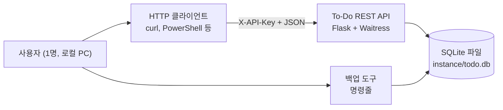

# 비즈니스 개요

## 비즈니스 컨텍스트 다이어그램



### 텍스트 대안
```text
사용자 -> HTTP 클라이언트(curl, PowerShell 등) -> To-Do REST API -> SQLite 파일
사용자 -> 백업 도구(명령줄) -> SQLite 파일
사용자는 웹 화면(/api_test) 또는 HTTP 클라이언트로 API를 호출한다. (웹 화면은 2차 워크플로에서 추가)
```

## 비즈니스 설명
- **설명**: 한 사람이 로컬 PC에서 할 일을 관리하기 위한 REST API와 그 API를 쓰는 웹 화면.
- **비즈니스 트랜잭션**:

| 트랜잭션 | 설명 |
|---|---|
| 할 일 추가 | 제목으로 새 할 일을 미완료 상태로 등록. 같은 제목(영문 대소문자 무시)의 활성 항목이 있으면 거부 |
| 목록 조회 | 삭제되지 않은 할 일을 최신 순으로 조회. 완료 여부로 필터 가능 |
| 단건 조회 | id로 할 일 하나를 조회 |
| 완료 상태 변경 | 완료/미완료를 양방향으로 변경 |
| 삭제 | 논리 삭제. 이후 모든 조회에서 제외되고 복구 불가 |
| 상태 확인 | 서버와 DB가 동작하는지 확인 (인증 불필요) |
| 백업/복원 | DB 사본 생성과 검증된 복원 (명령줄 도구) |

- **용어 사전**:

| 용어 | 의미 |
|---|---|
| 할 일 (Todo) | 제목, 완료 여부, 생성 시각을 가진 항목 |
| 활성 항목 | 삭제되지 않은 할 일. API로 보이는 것은 활성 항목뿐 |
| 논리 삭제 | 행을 지우지 않고 삭제 시각만 기록하는 삭제 |
| API 키 | `X-API-Key` 헤더로 보내는 32자 이상의 단일 비밀 값 |

## 컴포넌트 수준 설명

### todo_api (애플리케이션 패키지)
- **목적**: 할 일 관리 트랜잭션을 HTTP API로 제공
- **책임**: 인증, 요청 제한, 입력 검증, 업무 규칙 적용, 저장, 로깅

### todo_api.backup (운영 도구)
- **목적**: 데이터 유실 대비
- **책임**: 백업 생성과 무결성 검사, 보관 개수 관리, 복원

### tests (테스트)
- **목적**: 업무 규칙과 보안/복원력 요구사항의 회귀 방지
- **책임**: 예제 기반, 속성 기반, 복원력 테스트 161개
