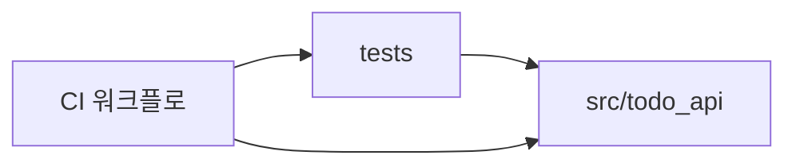

# 의존성

## 내부 의존성



### 텍스트 대안
```text
tests -> src/todo_api (테스트 대상)
CI 워크플로 -> tests, src/todo_api (실행과 스캔)
```

### tests 는 src/todo_api 에 의존
- **유형**: Test
- **이유**: 애플리케이션 모듈을 직접 가져와 검증한다 (`pyproject.toml`의 `pythonpath` 설정)

패키지 내부의 모듈 간 의존 관계는 `code-structure.md`의 "모듈 계층"에 있다.

## 외부 의존성

### 실행 (직접)
| 의존성 | 버전 | 목적 | 라이선스 |
|---|---|---|---|
| Flask | 3.1.3 | 웹 프레임워크 | BSD-3-Clause |
| Flask-Limiter | 4.1.1 | 요청 제한 | MIT |
| waitress | 3.0.2 | WSGI 서버 | ZPL-2.1 |

### 실행 (하위)
blinker 1.9.0, click 8.5.0, Deprecated 3.0.0, itsdangerous 2.2.0, Jinja2 3.1.6, limits 5.8.0, MarkupSafe 3.0.4, ordered-set 4.1.0, packaging 26.3, typing_extensions 4.16.0, Werkzeug 3.1.9, wrapt 2.5.0

### 개발/테스트 (직접)
| 의존성 | 버전 | 목적 | 라이선스 |
|---|---|---|---|
| pytest | 9.1.1 | 테스트 러너 | MIT |
| hypothesis | 6.169.0 | 속성 기반 테스트 | MPL-2.0 |
| pip-audit | 2.10.1 | 취약점 스캔 | Apache-2.0 |

하위 의존성 전체 목록과 버전은 `requirements-dev.txt`에 있다.
라이선스는 각 프로젝트가 공개한 정보를 기억에 의존해 적은 것이며 이번 분석에서 패키지 메타데이터로 대조하지는 않았다.
